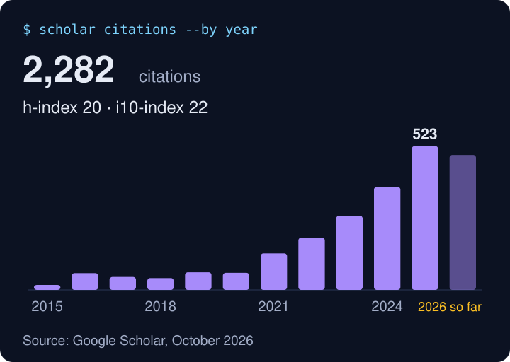

  <b>Data science · machine learning · agentic AI · product</b> 
  📍 Copenhagen, Denmark

  
  

  
  

---

### About me

I lead the architecture and hands-on development of **Ace Prompt** at Configit, an AI assistant that helps engineers build product models. Before that I built and led a five-person AI team at Brüel & Kjær Vibro, worked in data science at Liva Healthcare, and founded DivERS Tech.

At Configit I build tool-using agents with planning, subagents and human approval at high-risk steps, on LangGraph and Azure. We use evaluations and trace review to catch regressions before release.

**Stack:** agentic AI · LLM applications · RAG · LLM evaluation and tracing · LLM fine-tuning (BERT, FLAN-T5) · LangGraph · LangChain · Python · TypeScript · Next.js · PyTorch · FastAPI · MLflow · Docker · Azure · AWS

### Experience

**Configit** · Principal AI Engineer and interim Product Owner · 2025 to now

- Lead architecture and development of Ace Prompt, bringing agentic AI to Configit's configuration platform.
- Build tool-using deep agents with LangChain, LangGraph, TypeScript, Next.js and Azure.
- Build agent evaluations, execution tracing and guardrails.
- As interim Product Owner, turn customer needs into priorities, scope and delivery plans.

**Brüel & Kjær Vibro** · Head of AI and Analytics, Senior Data Scientist · 2022 to 2025

- Built and mentored an AI team of five for the BKV Beyond condition monitoring platform.
- Owned the AI roadmap for predictive maintenance and anomaly detection.
- Took deep learning time-series models from design to production with PyTorch, MLflow, FastAPI and AWS SageMaker.

**Liva Healthcare** · Data science · 2020 to 2022

- Built ML and deep learning models on health records, behavioral data and wearables, in a regulated setting.

### Shipping with coding agents

I use Claude Code and Codex daily to go from written acceptance criteria to tested pull requests. I stay accountable for design, review, runtime QA and release.

### DivERS Tech

Finding a job is painful, and hiring is full of bias. In 2020 I founded DivERS Tech to make recruitment fairer and more diverse with AI. The startup won Venture Cup's best digital startup award in Denmark and raised 630,000 DKK in public grants.

### Toolbox over time

### Research background

Before industry I did a PhD in photonics at DTU and a postdoc in ML for materials, and contributed to the open-source [GPAW](https://gpaw.readthedocs.io/) code. My 50+ papers have 2,200+ citations and an h-index of 20. Yearly citations grew every year from 2021 to 523 in 2025. I still collaborate with universities and co-supervise PhD and master's theses. See [Google Scholar](https://scholar.google.dk/citations?user=pPawr70AAAAJ).

### Connect

Happy to talk about agent architecture, AI evals and shipping with coding agents. [LinkedIn](https://www.linkedin.com/in/alirezataghizadeh/) · [Email](mailto:a.r.taghizadeh@gmail.com)
