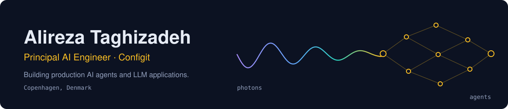
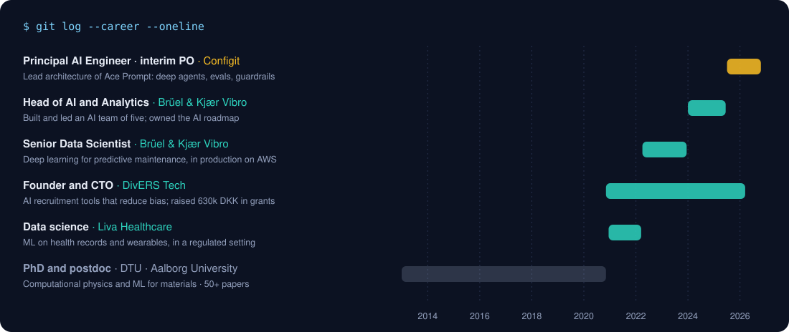
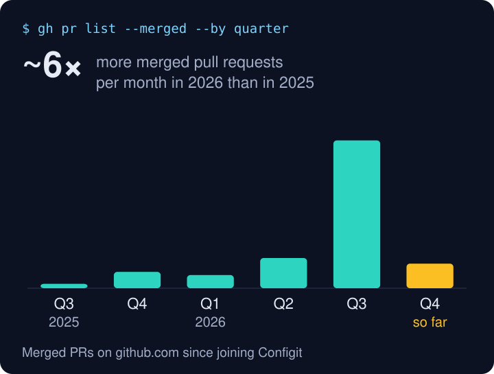
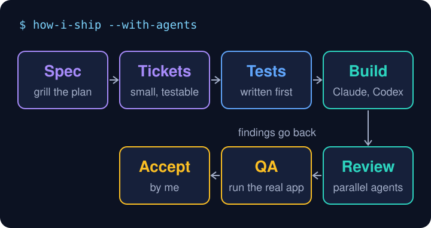
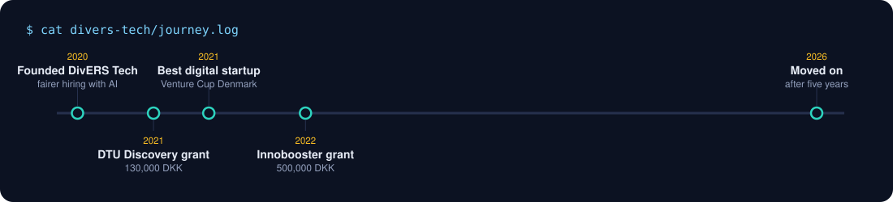
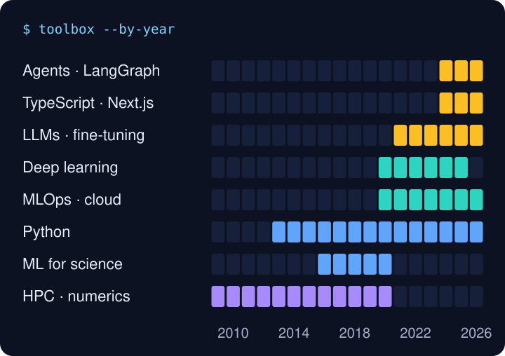
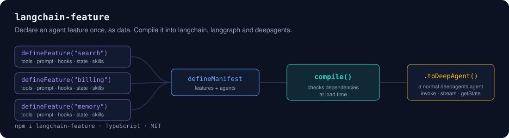

  <b>Agentic AI · LLM apps and fine-tuning · deep learning · Python &amp; TypeScript</b> 
  📍 Copenhagen, Denmark

  
  

  
  
  

---

### About me

I'm a Principal AI Engineer at Configit in Copenhagen. I lead the architecture of **Ace Prompt**, an AI assistant that helps engineers build product models. Before that I led an AI team at Brüel & Kjær Vibro, ran data science at Liva Healthcare, and founded DivERS Tech.

I design and build deep agentic systems: tool-using agents with planning, subagents, memory and human-in-the-loop steps, running in production on LangGraph and Azure. I treat evals as part of the product. Every agent ships with evaluation suites, execution tracing and guardrails, so we know when a change makes it better or worse.

I work hands-on in Python and TypeScript, and I build most of my code with coding agents.

### Experience

<b>Configit</b> · Principal AI Engineer and interim Product Owner · 2025 to now

- Lead architecture and development of Ace Prompt, bringing agentic AI to Configit's configuration platform.
- Build tool-using deep agents with LangChain, LangGraph, TypeScript, Next.js and Azure.
- Build agent evaluations, execution tracing and guardrails.
- As interim Product Owner, turn customer needs into priorities, scope and delivery plans.

<b>Brüel &amp; Kjær Vibro</b> · Head of AI and Analytics, Senior Data Scientist · 2022 to 2025

- Built and mentored an AI team of five for the BKV Beyond condition monitoring platform.
- Owned the AI roadmap for predictive maintenance and anomaly detection.
- Took deep learning time-series models from design to production: PyTorch, MLflow, FastAPI, AWS SageMaker.

<b>Liva Healthcare</b> · Data science · 2020 to 2022

- ML and deep learning on health records, behavioral data and wearables, in a regulated setting.
- Improved the team's workflows and tooling, and mentored team members.

### Shipping with coding agents

I use Claude Code and Codex every day. With them I now ship about ten times more changes than a year ago.

Speed only matters if the code is right. So every change goes through the same steps, and I sign off on each one myself.

### DivERS Tech: my startup journey

In 2020 I founded DivERS Tech to make hiring fairer with AI. We built tools that spot and reduce bias in recruitment, won Venture Cup's best digital startup award, and raised 630,000 DKK in public grants. I ran it next to my day job until 2026.

**What I learned**

- Talk to customers before you train a model. The data you need comes from them.
- Grants buy time, not product-market fit.
- A small team ships when every person owns one part end to end.

### Toolbox over time

### Side project

### Research background

Before industry I did a PhD in photonics at DTU and a postdoc in ML for materials: 50+ papers, h-index 20, 2,100+ citations, and contributions to the open-source [GPAW](https://gpaw.readthedocs.io/) code. See [Google Scholar](https://scholar.google.dk/citations?user=pPawr70AAAAJ).

### Connect

Happy to talk about agent architecture, AI evals and shipping with coding agents. [LinkedIn](https://www.linkedin.com/in/alirezataghizadeh/) · [Email](mailto:a.r.taghizadeh@gmail.com)
